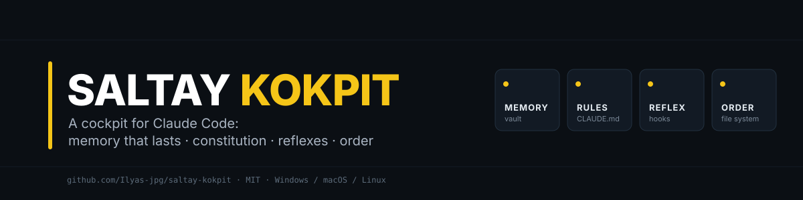
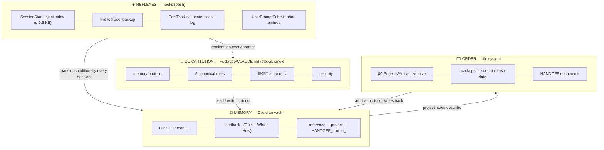

<p align="center">
  
</p>

<p align="center">
  <a href="LICENSE"></a>
  
  
  
  <a href="README.md"></a>
</p>

**Saltay Kokpit** is an open-source operating layer that turns Claude Code into a teammate that
*remembers*, keeps its own files in order, and can be audited. Persistent memory (an Obsidian
vault), a behaviour constitution (`CLAUDE.md`), reflexes (hooks) and file discipline
(active/archive) in one package. One-command install; never touches your existing settings.

The name comes from the author's surname and from the cockpit: the place with the instruments,
the autopilot and the red buttons. Claude flies; you set the route and the limits.

> **v1.1 (2026-10-22):** after seven more weeks of real use. The constitution became "a loading policy,
> not a document" (~11 KB); the two long reminders on every prompt (1.7 KB) became one short reminder
> (~500 B); the skill rule became "a skill is not a default", the subagent rule "allowed, hanging
> forbidden"; three new vault templates and 17 new lessons. Upgrading from v1.0 is one command
> ([below](#upgrading-from-v10)); every change is in the [CHANGELOG](CHANGELOG.md).

> Full docs (`docs/`) are in Turkish for now. This README explains the whole system; translations are welcome.

---

## Contents

- [What it is, who it is for](#what-it-is-who-it-is-for)
- [The problem](#the-problem)
- [The solution: four layers](#the-solution-four-layers)
- [How a session flows](#how-a-session-flows)
- [Install in 5 minutes](#install-in-5-minutes)
- [Repository layout](#repository-layout)
- [The backbone: rules and reflexes](#the-backbone-rules-and-reflexes)
- [Lessons from real failures](#lessons-from-real-failures)
- [Glossary](#glossary)
- [Honest limits](#honest-limits)
- [Roadmap](#roadmap)
- [Contributing, security, license](#contributing-security-license)

## What it is, who it is for

Claude Code starts **every session from zero**. Who you are, which projects exist, how to reach
which server, what was decided yesterday, the thing you said "never do this again" about last
week: all gone. This repository is the **de-personalised** version of a system built over seven
months on a single machine across 100+ real projects (corporate sites, admin panels, bots, a video
pipeline, disaster tools) to break that reset.

| In numbers | v1.0 (September) | v1.1 (October) |
|---|---|---|
| Vault notes | 375 | 534 (+43 archived) |
| Behaviour rules (`feedback_`) | 128 | 188 |
| Project notes | 89 | 124 |
| Documented "real failure → rule" lessons | 21 | 38 |
| Constitution (`CLAUDE.md`, loaded in every session) | 24 KB | 11-14 KB |

Not theory: every rule has a dated incident behind it ([docs/10-dersler.md](docs/10-dersler.md), TR).

**Who it is for:** anyone producing daily work with Claude Code: freelancers, agencies, students
with side projects. Especially if you find yourself saying "I explain the same thing every
session", "it keeps asking for permission", "it changed the part I didn't ask for", "it said low
risk and the site went down".

**Who it is not for:** one-off Q&A use; Claude API/SDK integration (this is a working system, not
an application). The constitution and vault layers can be adapted to other agents such as Cursor
or Codex; the hooks are Claude Code specific.

## The problem

- **No memory.** You say "remember"; it gets written, never read in the next session.
- **Conditional instructions don't work.** *"Check the notes if the task relates to the past"*
  leaves the decision to the model's momentary judgement. That was the root cause of three months
  of "sometimes it acts like it has no memory".
- **Claude Code's own memory folder is bound to the working directory.** Open another folder and
  it's gone; the same fact in two places ends in contradiction.
- **It asks for permission, widens the scope, says "low risk".** You make the same correction every session.
- **Silent failures.** When a hook's output exceeds 10,000 characters Claude sees only a 2 KB
  preview; a release empties the hook variables and backups silently stop for two weeks. Nobody notices.

## The solution: four layers



| Layer | What it does | Where |
|---|---|---|
| **Memory** | Flat `.md` notes with prefixes and frontmatter. The index arrives in every session **unconditionally**; it measures itself and never reaches the 10K limit. | `templates/vault-en/` → `~/Documents/ClaudeVault` |
| **Constitution** | The behaviour core: memory protocol, 5 canonical rules, traffic light, three-line security, setup principles, anti-pattern list. Behaviour, not knowledge; inventory and history live in the vault. | `templates/CLAUDE.en.md` → `~/.claude/CLAUDE.md` |
| **Reflexes** | Jobs never left to the model's will: load the index, back up before edits, scan for secrets, remind the rules. | `hooks/` → `~/.claude/hooks/` + `settings.json` |
| **Order** | Active/archive folders, reversible deletion, handoff documents; scripts to open/close projects. | `scripts/` |

## How a session flows

1. The session opens. The hook prints the vault index: *"534 notes · core: profile, 5 rules, skill routing · feedback: … · projects: …"*
2. You: *"push the hero section of example-site live."*
3. On every prompt the hook adds a short reminder: read and write the vault, keep the brief's end, never ask for permission outside red.
4. The model sees `project_example_site` and `HANDOFF_example_site` in the index and **does not answer before reading them**: the deploy command, backup path and never-again list are there.
5. Before deploying it simulates the risk (home page, apex domain, language switch). Every file it edits is copied to `.backups/` first.
6. It verifies live and shows evidence; it never says "uploaded, done".
7. You: *"from now on, no sound in hero videos."* The model writes `feedback_hero_video_sound.md` (Rule + Why + How to apply), adds one line to `MEMORY.md`, notifies you in one sentence.
8. Next day, in another folder: step 1 repeats exactly. **You explain nothing.**

## Install in 5 minutes

Requirements: Claude Code and bash. On Windows, Git for Windows is enough; Claude Code already
requires it. With node or python3 present, `settings.json` is merged automatically; otherwise a
ready file is left for a manual merge.

```bash
git clone https://github.com/Ilyas-jpg/saltay-kokpit.git
cd saltay-kokpit
bash scripts/install.sh --lang en --name "Your Name"
```

From Windows PowerShell:

```powershell
powershell -ExecutionPolicy Bypass -File scripts\install.ps1 -Lang en -Name "Your Name"
```

The installer is idempotent: it never overwrites without a timestamped backup. To look first, use `--dry-run`.

| Step | Target |
|---|---|
| Vault templates | `~/Documents/ClaudeVault/` (existing notes untouched) |
| Projects folder skeleton | `~/Desktop/00-Projects/{Active,Archive,_tools,_backups}` |
| Hooks, `vault.conf`, reminder | `~/.claude/hooks/`, `~/.claude/vault.conf`, `~/.claude/session-reminder.json` |
| Constitution | `~/.claude/CLAUDE.md`; **left alone if it exists**, `CLAUDE.saltay.md` written next to it |
| Hook registration | merged into `~/.claude/settings.json` (backup taken, no duplicate commands) |
| Verification | index size and stdin JSON test |

Options: `--lang tr` · `--vault DIR` · `--projects DIR` · `--claude-home DIR` · `--dry-run`.

Then: restart Claude Code; the index should arrive at session start. Open the vault in Obsidian
with *Open folder as vault*. Fill `user_profile.md`, or just tell Claude in the first session and it writes it.

Health check, the first command whenever Claude "seems to forget":

```bash
bash scripts/vault-health.sh
```

Opening and closing projects:

```bash
bash scripts/new-project.sh "Client Site" --desc "Corporate site + quote form"
bash scripts/archive-project.sh "Client Site" --reason "delivered"
```

### Upgrading from v1.0

```bash
git pull
bash scripts/install.sh --lang en
```

The installer removes the two old reminders from `settings.json` by exact command match, adds the new
one and renames the two old files to `.<date>.bak`; it touches no other hook. Your `CLAUDE.md` and vault
notes are never overwritten: the new constitution is written to `CLAUDE.saltay.md`, three new vault
templates are added, and templates in your vault that still carry the v1.0 text are listed at the end
(compare them by hand).

## Repository layout

```
saltay-kokpit/
├── README.md · README.en.md · LICENSE · CONTRIBUTING.md · SECURITY.md · CHANGELOG.md
├── docs/                        (Turkish) why · vault · constitution · file system · hooks ·
│                                skills/agents/MCP · security & publishing · Windows · FAQ · 38 lessons
├── templates/
│   ├── CLAUDE.md · CLAUDE.en.md            constitution (placeholders filled at install)
│   ├── vault/ · vault-en/                  vault skeleton: README, MEMORY, profile, 5 rules, skill routing,
│   │                                       verification surface, setup inventory, constitution history, templates, archive
│   ├── reminders/                          UserPromptSubmit reminder (tr/en, ~500 B)
│   ├── project/.gitignore                  project .gitignore that excludes AI working files
│   ├── project/launch.json.example         Browser pane dev-server registry
│   └── auto-memory-redirect.md             redirect for Claude Code's own memory folder
├── hooks/
│   ├── vault-index.sh           SessionStart: self-measuring index (levels 0-5 + failsafe)
│   ├── hook-meta.sh             stdin JSON → tool_name|file_path
│   ├── settings.hooks.json      block merged into settings.json
│   ├── settings.remove.json     an older release's commands (removed on upgrade)
│   └── README.md                hook table + optional hooks (TR)
├── scripts/
│   ├── install.sh · install.ps1 installer (idempotent)
│   ├── vault-health.sh          health check
│   ├── new-project.sh           Active/<name> + .gitignore + git + vault note + MEMORY line
│   ├── archive-project.sh       Active → Archive (reversible) + vault status + decision entry
│   └── merge-settings.js/.py    settings.json merger
└── assets/                      banner
```

## The backbone: rules and reflexes

**5 canonical behaviour rules** (one line per rule in the constitution; full text in `templates/vault-en/feedback_5_canonical_rules.md`):

| | Rule | One sentence |
|---|---|---|
| K0 | The brief's end | The brief's last paragraph and in-session bans never get lost |
| K1 | Literal interpretation | "From scratch" = 100 %, "just try" = test, "don't use" = banned |
| K2 | Continue autonomously | Never ask for permission; genuine A/B/C preferences and 🔴 risks may be asked; never hand the user work you can do |
| K3 | Assess risk strictly | Before delete/deploy: grep the vault + simulate the user's path; drive the browser on this computer |
| K4 | A skill is not a default | Call it if it gives knowledge you lack, specific to the job/version; not for general advice |
| K5 | Narrow scope | Verb + object; no widening via "it would be better"; measure side issues silently, report at the end |

**Traffic light:** 🟢 edit, read, test, verified deploys on your own sites: don't ask · 🟡 refactor, DNS,
schema: do it, report it · 🔴 money, irreversible deletion, legal, a client's live site, public
publishing, domains: stop, ask. "You have full authority" does not lift red.

**Subagents:** allowed, hanging forbidden. An `Agent` call blocks the message; no agents for research,
5-8 parallel searches in one message instead; large jobs get a time limit and an estimate up front.

**Vault prefixes:** `user_` `personal_` `feedback_` `reference_` `project_` `HANDOFF_` `note_`.
The hook groups names by prefix; `feedback_` names are never trimmed at any compression level.

**Hooks:** `SessionStart` index · `UserPromptSubmit` short reminder (~500 B) · `PreToolUse` backup ·
`PostToolUse` secret scan + change log.

## Lessons from real failures

Six examples; all 38 in [docs/10-dersler.md](docs/10-dersler.md) (TR).

1. **A conditional memory instruction** produced three months of "it sometimes forgets". Rule: memory loads unconditionally.
2. **When the hook output passed 10K**, Claude was blind to 85 % of the index. Rule: the index measures itself and compresses in levels.
3. **A hook variable came back empty after a release**; backups silently stopped for two weeks. Rule: stdin JSON + actual tests.
4. **Six parallel subagents** produced 75 minutes of silence and were banned; two months later the ban was
   lifted and research agents went silent for 56-60 minutes again. An `Agent` call blocks the message.
   Rule: no agents for research, parallel searches instead.
5. **The reminder added to every prompt** was the fourth copy of the same rules; half of the 24 KB
   constitution was inventory. Rule: the constitution is a loading policy, not a document.
6. **`journalctl --vacuum`** deleted ten days of attack logs. Rule: logs are never deleted.

## Glossary

| Term | Meaning |
|---|---|
| **Vault** | A flat folder of `.md` files opened in Obsidian; Claude's persistent memory. |
| **Index** | The list of note *names* in the vault. The lean form arrives via the hook every session; the rich form is `MEMORY.md`. |
| **Constitution** | `~/.claude/CLAUDE.md`. Carries behaviour, not knowledge; single and global. |
| **Canonical rule** | One of the 5 (+1) meta-rules distilled from recurring corrections. |
| **Feedback note** | The three parts of a correction: Rule + Why + How to apply. Binding. |
| **HANDOFF** | A project's operational handoff document: status, runbook, deploy, "never again". |
| **Skill decision** | One question: does this skill give knowledge I don't have, specific to the job or the version? If yes call it, if not don't. |
| **Loading policy** | Whatever loads in every session (constitution, reminder, plugins, agent definitions) carries only the core that holds in every session. |
| **Reversible move** | Moving to `.curation-trash-<date>/` instead of deleting; manifest + restore command. |
| **Compression level** | The step (0-5) the index takes to fit its budget. Level ≥4 = time to archive. |

## Honest limits

- **One person's calibration.** The rules were distilled from one working style; fork it, add your
  own incidents. The system starts paying off when it learns from *your* mistakes.
- **The root gets messy.** After six months the project root held 399 items. The archive protocol
  and reversible moves exist precisely for that; an occasional cleanup session is needed.
- **Rules bloat too.** The author's constitution was cut from 24 KB to 10.9 KB and grew back to 13.6 KB
  within three weeks; the index runs at compression level 4 today. Re-measure with every new model generation.
- **Hooks are bash.** Git Bash is required on Windows. Don't port them to PowerShell; they break.
- **The 10K limit is version-dependent** (seen on Claude Code ≥ 2.1.88). The script is harmless on older versions.
- **The vault is personal.** Never in a public repo; synced or private backup, credentials kept outside.
- **Docs are Turkish for now.** This README explains the whole system; doc translations are open to contribution.
- This repository was prepared with Claude Code using the system itself; the scripts were tested
  end-to-end in a sandboxed HOME (TR fresh install, EN merge into existing settings, upgrade from
  v1.0, re-run, project open/archive, health check).

## Roadmap

- English translation of `docs/`.
- Community testing on macOS and Linux (the scripts are POSIX; the author develops on Windows).
- An adaptation note for the constitution and vault layers on agents other than Claude Code.

## Contributing, security, license

Translations, hook ports for other OS/shells, and your own "incident → rule" lessons (without
personal data) are welcome. Generic "best practice" lists are not; every rule needs a story.
[CONTRIBUTING.md](CONTRIBUTING.md) · [CODE_OF_CONDUCT.md](CODE_OF_CONDUCT.md) ·
security reports via [SECURITY.md](SECURITY.md) · releases in [CHANGELOG.md](CHANGELOG.md).

MIT license. **İlyas Saltay** · [ilyassaltay.com](https://ilyassaltay.com) · [algow.net](https://algow.net) ·
[github.com/Ilyas-jpg](https://github.com/Ilyas-jpg)
