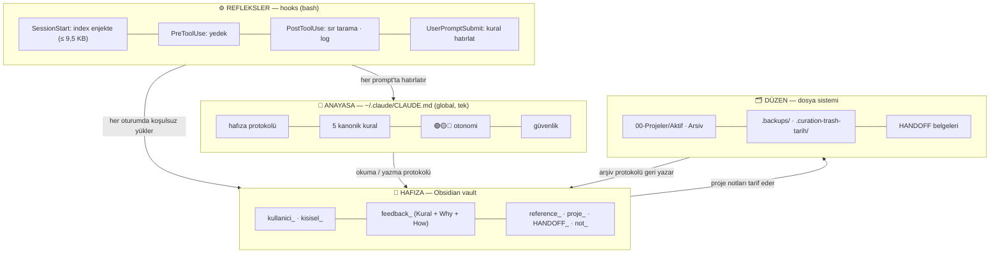

<p align="center">
  
</p>

<p align="center">
  <a href="LICENSE"></a>
  
  
  
  <a href="README.en.md"></a>
</p>

**Saltay Kokpit**, Claude Code'u *unutmayan*, kendi düzenini kuran ve denetlenebilir bir çalışma
arkadaşına çeviren açık kaynak kurulumdur. Kalıcı hafıza (Obsidian vault), davranış anayasası
(`CLAUDE.md`), refleksler (hook'lar) ve dosya disiplini (aktif/arşiv) tek pakette. Tek komutla
kurulur, mevcut ayarlarına dokunmaz.

Adını yazarın soyadından ve pilot kabininden alır. Kokpit, göstergelerin, otomatik pilotun ve
kırmızı düğmelerin olduğu yerdir: uçuşu Claude yapar, rotayı ve sınırları sen belirlersin.

---

## İçindekiler

- [Bu ne, kimin için](#bu-ne-kimin-için)
- [Sorun](#sorun)
- [Çözüm: dört katman](#çözüm-dört-katman)
- [Bir oturum nasıl akar](#bir-oturum-nasıl-akar)
- [5 dakikada kurulum](#5-dakikada-kurulum)
- [Depo yapısı](#depo-yapısı)
- [Omurga: kurallar ve refleksler](#omurga-kurallar-ve-refleksler)
- [Gerçek hatalardan çıkan dersler](#gerçek-hatalardan-çıkan-dersler)
- [Sözlük](#sözlük)
- [Dürüst sınırlar](#dürüst-sınırlar)
- [Yol haritası](#yol-haritası)
- [Katkı, güvenlik, lisans](#katkı-güvenlik-lisans)

## Bu ne, kimin için

Claude Code varsayılan olarak **her oturumu sıfırdan** başlatır. Sen kimsin, hangi projeler var,
hangi sunucuya nasıl girilir, dün ne kararlaştırıldı, geçen hafta "bunu bir daha yapma" dediğin
şey: hepsi gider. Bu depo, altı ay boyunca tek bir bilgisayarda, yüzden fazla gerçek projede
(kurumsal siteler, yönetim panelleri, botlar, video hattı, afet araçları) o sıfırlamayı kırmak için
kurulan sistemin **kişisel ve müşteri verisi ayıklanmış** halidir.

| Sayılarla | |
|---|---|
| Vault notu | 375 |
| Davranış kuralı (`feedback_`) | 128 |
| Proje notu | 89 |
| Belgelenmiş "gerçek hata → kural" dersi | 21 |

Teori değil: her kuralın arkasında tarihli bir olay var ([docs/10-dersler.md](docs/10-dersler.md)).

**Kimin için:** Claude Code ile günlük iş üreten herkes: freelancer, ajans, yan proje yapan öğrenci.
Özellikle "her oturumda aynı şeyi anlatıyorum", "sürekli izin soruyor", "istemediğim yeri de
değiştirdi", "düşük risk dedi, site düştü" diyenler için.

**Kimin için değil:** tek seferlik soru-cevap kullanımı; Claude API/SDK entegrasyonu (bu bir
uygulama değil, çalışma sistemi). Cursor, Codex gibi başka ajanlara anayasa ve vault katmanı
uyarlanabilir, hook'lar Claude Code'a özgüdür.

## Sorun

- **Hafıza yok.** "Hatırla" dersin; yazılır ama bir sonraki oturumda okunmaz.
- **Koşullu talimat çalışmaz.** *"Geçmişle ilgiliyse notlara bak"* dediğinde karar modelin o anki
  yargısına kalır. Üç ay boyunca "bazen hafızası yokmuş gibi" davranmasının kök nedeni buydu.
- **Claude Code'un kendi hafıza dizini çalışma klasörüne bağlı.** Başka klasörde açınca yok; iki
  yerde aynı bilgi, sonunda çelişki.
- **İzin sorar, kapsam genişletir, "düşük risk" der.** Aynı düzeltmeyi her oturumda yeniden yaparsın.
- **Sessiz arızalar.** Hook çıktısı 10.000 karakteri aşınca Claude sadece 2 KB önizleme görür; bir
  sürüm hook değişkenlerini boşaltır ve yedekler iki hafta sessizce alınmaz. Kimse fark etmez.

## Çözüm: dört katman



| Katman | Ne yapar | Nerede |
|---|---|---|
| **Hafıza** | Düz `.md` notlar, prefix'li, frontmatter'lı. Index'i her oturuma **koşulsuz** gelir; kendini ölçer, 10K sınırına asla ulaşmaz. | `templates/vault/` → `~/Documents/ClaudeVault` |
| **Anayasa** | Davranış çekirdeği: hafıza protokolü, 5 kanonik kural, trafik ışığı, skill refleksi, güvenlik, anti-pattern listesi. Bilgi değil, davranış. | `templates/CLAUDE.md` → `~/.claude/CLAUDE.md` |
| **Refleksler** | Modelin iradesine bırakılmayan işler: index yükle, düzenlemeden önce yedekle, sır tara, kuralı hatırlat. | `hooks/` → `~/.claude/hooks/` + `settings.json` |
| **Düzen** | Aktif/arşiv klasörleri, geri-dönülebilir silme, devir belgeleri; proje aç/kapat script'leri. | `scripts/` |

## Bir oturum nasıl akar

1. Oturum açılır. Hook, vault index'ini basar: *"375 not · çekirdek: profil, 5 kural, skill routing · feedback: … · proje: …"*
2. Sen: *"örnek-site'nin hero'sunu canlıya al."*
3. Hook her prompt'ta 5 kuralı ve skill tier kontrolünü hatırlatır.
4. Model index'te `proje_ornek_site` ve `HANDOFF_ornek_site` görür, **okumadan cevap vermez**: deploy komutu, yedek yolu, "bir daha yapma" listesi oradadır.
5. Deploy öncesi riski simüle eder (ana sayfa, apex domain, dil değişimi). Düzenlediği her dosyadan önce `.backups/`'a kopya düşer.
6. Canlıda doğrular, kanıt gösterir; "yükledim, oldu" demez.
7. Sen: *"bundan sonra hero videolarında ses olmasın."* Model `feedback_hero_video_ses.md` yazar (Kural + Why + How to apply), `MEMORY.md`'ye bir satır ekler, tek cümleyle bildirir.
8. Ertesi gün, başka klasörde: 1. adım aynen tekrar eder. **Hiçbir şey anlatmazsın.**

## 5 dakikada kurulum

Gereksinim: Claude Code ve bash. Windows'ta Git for Windows yeter; Claude Code onu zaten istiyor.
Node veya python3 varsa `settings.json` otomatik birleştirilir; yoksa elle birleştirmen için hazır
dosya bırakılır.

```bash
git clone https://github.com/Ilyas-jpg/saltay-kokpit.git
cd saltay-kokpit
bash scripts/install.sh --lang tr --name "Adın"
```

Windows PowerShell'den:

```powershell
powershell -ExecutionPolicy Bypass -File scripts\install.ps1 -Lang tr -Name "Adın"
```

Kurulum idempotent: var olan dosyaya dokunmaz, gerektiğinde tarihli yedek alır. Önce görmek
istersen `--dry-run`.

| Adım | Hedef |
|---|---|
| Vault şablonları | `~/Documents/ClaudeVault/` (var olan notlara dokunmaz) |
| Proje klasörü iskeleti | `~/Desktop/00-Projeler/{Aktif,Arsiv,_araclar,_yedekler}` |
| Hook'lar, `vault.conf`, hatırlatıcılar | `~/.claude/hooks/`, `~/.claude/vault.conf`, `~/.claude/*-reminder.json` |
| Anayasa | `~/.claude/CLAUDE.md`; **varsa dokunmaz**, yanına `CLAUDE.saltay.md` yazar |
| Hook kaydı | `~/.claude/settings.json`'a birleştirir (yedek alır, aynı komutu iki kez eklemez) |
| Doğrulama | index boyutu ve stdin JSON testi |

Seçenekler: `--lang en` · `--vault DIR` · `--projects DIR` · `--claude-home DIR` · `--dry-run`.

Sonra: Claude Code'u yeniden başlat; oturum başında index gelmeli. Obsidian'da *Open folder as
vault* ile vault'u aç. `kullanici_profil.md`'yi doldur ya da ilk oturumda Claude'a anlat, o yazar.

Sağlık kontrolü, Claude "unutuyor gibi" olduğunda ilk komut:

```bash
bash scripts/vault-health.sh
```

Proje açmak ve kapatmak:

```bash
bash scripts/new-project.sh "Müşteri Sitesi" --desc "Kurumsal site + teklif formu"
bash scripts/archive-project.sh "Müşteri Sitesi" --reason "teslim edildi"
```

## Depo yapısı

```
saltay-kokpit/
├── README.md · README.en.md · LICENSE · CONTRIBUTING.md · SECURITY.md · CHANGELOG.md
├── docs/
│   ├── 01-neden.md              sorun, felsefe, dört katman, bir oturumun akışı
│   ├── 02-hafiza-vault.md       prefix sistemi, iki index, 10K sınırı, sıkışma seviyeleri, arşiv
│   ├── 03-anayasa.md            CLAUDE.md bölümleri, 5 kural, trafik ışığı, bakım
│   ├── 04-dosya-sistemi.md      Aktif/Arşiv, geri-dönülebilir taşıma, yedek katmanları, HANDOFF
│   ├── 05-hooklar.md            her hook'un nedeni, kendini ölçen index, "tetikleniyor ≠ çalışıyor"
│   ├── 06-skill-agent-mcp.md    tier sistemi, signal vs noise, subagent, MCP denetimi
│   ├── 07-guvenlik-ve-yayin.md  kod güvenliği asgarisi, log silme yasağı, GitHub hijyeni
│   ├── 08-windows.md            iki kabuk, UTF-8, backtick tuzağı, yollar
│   ├── 09-sss.md                sorun giderme
│   └── 10-dersler.md            21 gerçek olay → kural
├── templates/
│   ├── CLAUDE.md · CLAUDE.en.md            anayasa (yer tutucular kurulumda dolar)
│   ├── vault/ · vault-en/                  vault iskeleti: README, MEMORY, profil, 5 kural, şablonlar, arşiv
│   ├── reminders/                          UserPromptSubmit hatırlatıcıları (tr/en)
│   ├── project/.gitignore                  AI dosyalarını dışlayan proje .gitignore'u
│   ├── project/launch.json.example         Browser pane dev sunucu kaydı
│   └── auto-memory-redirect.md             Claude Code'un kendi hafıza dizini için yönlendirme
├── hooks/
│   ├── vault-index.sh           SessionStart: kendini ölçen index (seviye 0-5 + failsafe)
│   ├── hook-meta.sh             stdin JSON → tool_name|file_path
│   ├── settings.hooks.json      settings.json'a birleştirilecek blok
│   └── README.md                hook tablosu + isteğe bağlı hook'lar
├── scripts/
│   ├── install.sh · install.ps1 kurulum (idempotent)
│   ├── vault-health.sh          sağlık kontrolü
│   ├── new-project.sh           Aktif/<ad> + .gitignore + git + vault notu + MEMORY satırı
│   ├── archive-project.sh       Aktif → Arsiv (geri alınabilir) + vault status + karar kaydı
│   └── merge-settings.js/.py    settings.json birleştirici
└── assets/                      banner
```

## Omurga: kurallar ve refleksler

**5 kanonik davranış kuralı** (her prompt'ta hatırlatılır; ayrıntı [docs/03-anayasa.md](docs/03-anayasa.md)):

| | Kural | Tek cümle |
|---|---|---|
| K0 | Son 5 mesajı tara | Oturum-içi yasaklar ve brief'in son paragrafı kaybolmaz |
| K1 | Literal yorum | "Sıfırdan" = %100, "denesene" = test, "kullanma" = yasak |
| K2 | Otonom devam | İzin sorma; gerçek tercih (A/B/C) ve 🔴 risk sorulabilir |
| K3 | Riski sıkı değerlendir | Silme/deploy öncesi vault grep + kullanıcı yolunu simüle et |
| K4 | Skill görünür | Tier 1 çağır / Tier 3 atla; kararı söyle |
| K5 | Scope dar | Fiil + nesne; "daha iyi olur" ile genişletme yok |

**Trafik ışığı:** 🟢 düzenle, oku, test et: sorma · 🟡 refactor, DNS, şema: yap, raporla · 🔴 para,
geri alınamaz silme, yasal, public yayın, domain: dur, sor. "Tam yetki sende" kırmızıyı kaldırmaz.

**Vault prefix'leri:** `kullanici_` `kisisel_` `feedback_` `reference_` `proje_` `HANDOFF_` `not_`.
Hook adları prefix'e göre bölümler; `feedback_` adları hiçbir sıkışma seviyesinde kırpılmaz.

**Hook'lar:** `SessionStart` index · `UserPromptSubmit` kural hatırlatma · `PreToolUse` yedek ·
`PostToolUse` sır tarama + değişiklik logu.

## Gerçek hatalardan çıkan dersler

Beş örnek; 21'inin tamamı [docs/10-dersler.md](docs/10-dersler.md)'de.

1. **Koşullu hafıza talimatı** üç ay boyunca "bazen unutuyor" üretti. Kural: hafıza koşulsuz yüklenir.
2. **Hook çıktısı 10K'yı aşınca** Claude index'in %85'ini görmüyordu. Kural: index kendini ölçer, kademeli sıkışır.
3. **Hook değişkeni bir sürümde boş geldi**, yedekler iki hafta sessizce alınmadı. Kural: stdin JSON + fiili test.
4. **Altı paralel subagent** işi doğru yaptı ama 1,4 milyon token ve 75 dakika sessizlik üretti. Kural: varsayılan kapalı.
5. **`journalctl --vacuum`** on günlük saldırı logunu sildi. Kural: log hiç silinmez.

## Sözlük

| Terim | Anlamı |
|---|---|
| **Vault** | Obsidian'da açılan düz `.md` klasörü; Claude'un kalıcı hafızası. |
| **Index** | Vault'taki not *adlarının* listesi. Yalın hali hook'la her oturuma gelir; zengin hali `MEMORY.md`. |
| **Anayasa** | `~/.claude/CLAUDE.md`. Bilgi değil davranış taşır; tek ve global. |
| **Kanonik kural** | Tekrarlanan düzeltmelerin damıtıldığı 5 (+1) meta-kural. |
| **Feedback notu** | Bir düzeltmenin üç parçası: Kural + Why + How to apply. Bağlayıcıdır. |
| **HANDOFF** | Bir projenin operasyonel devir belgesi: durum, runbook, deploy, "bir daha yapma". |
| **Tier** | Skill'in değer sınıfı: 1 çağır, 2 durumla, 3 atla. Karar her zaman söylenir. |
| **Geri-dönülebilir taşıma** | Silmek yerine `.curation-trash-<tarih>/`'e taşımak; manifest + geri alma komutu. |
| **Sıkışma seviyesi** | Index'in bütçeye sığmak için uyguladığı kademe (0-5). Seviye ≥4 = arşivleme zamanı. |

## Dürüst sınırlar

- **Tek kişinin kalibrasyonu.** Kurallar bir çalışma tarzından damıtıldı; fork'la, kendi olaylarını
  ekle. Sistem *senin* hatalarından öğrenmeye başladığında işe yarar.
- **Kök dağılır.** Altı ay sonra proje kökünde 399 öğe vardı. Arşiv protokolü ve geri-dönülebilir
  taşıma tam bu yüzden var; ara sıra temizlik oturumu gerekir.
- **Hook'lar bash.** Windows'ta Git Bash şart. PowerShell'e çevirme, bozulur.
- **10K sınırı sürüme bağlı** (Claude Code ≥ 2.1.88'de görüldü). Script eski sürümlerde de zararsızdır.
- **Vault kişiseldir.** Public repoya asla; senkron ya da private yedek, credential dışarıda.
- **Dokümanlar şimdilik Türkçe.** README'nin İngilizcesi sistemi eksiksiz anlatır; doküman çevirisi
  katkıya açık.
- Bu depo, sistemin kendisi kullanılarak Claude Code ile birlikte hazırlandı; script'ler sanal bir
  HOME'da uçtan uca test edildi (TR temiz kurulum, EN mevcut ayarlara birleştirme, proje aç/arşivle,
  sağlık kontrolü).

## Yol haritası

- `docs/` İngilizce çevirisi.
- macOS ve Linux'ta topluluk testleri (script'ler POSIX; yazar Windows'ta geliştirdi).
- Anayasa ve vault katmanının Claude Code dışındaki ajanlar için uyarlama notu.

## Katkı, güvenlik, lisans

Çeviri, başka OS/kabuk için hook portu, kendi "olay → kural" derslerin (kişisel veri olmadan) hoş
gelir. Generic "best practice" listeleri gelmez; her kuralın bir hikâyesi olmalı.
[CONTRIBUTING.md](CONTRIBUTING.md) · [CODE_OF_CONDUCT.md](CODE_OF_CONDUCT.md) ·
güvenlik bildirimi için [SECURITY.md](SECURITY.md) · sürümler [CHANGELOG.md](CHANGELOG.md).

MIT lisansı. **İlyas Saltay** · [ilyassaltay.com](https://ilyassaltay.com) · [algow.net](https://algow.net) ·
[github.com/Ilyas-jpg](https://github.com/Ilyas-jpg)
